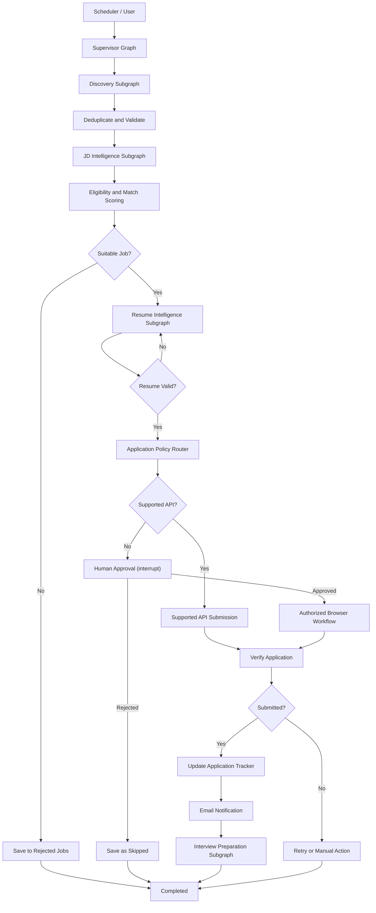

# ApplyPilot AI — System Architecture

## 1. Six-Layer Modular Architecture

| Layer | Technology | Responsibility |
|---|---|---|
| **Web Frontend** | Next.js, React, Tailwind CSS | Shared 8-section operations dashboard & live SSE/WS workflow monitor |
| **Desktop Shell** | Tauri (Windows) | Native tray controls, autostart, desktop notifications, OS credential integration, secure local file access |
| **API & Business Logic** | FastAPI | Single source of backend business logic, REST endpoints, SSE/WebSocket streaming, auth |
| **Intelligence & Orchestration** | LangGraph + Gemini / Claude / OpenAI | Supervisor graph, 4 specialized subgraphs, PostgreSQL checkpointing, task-routed LLM router |
| **Data & Queues** | PostgreSQL (`pgvector`) + Redis + Celery | Relational source of truth, vector retrieval, workflow checkpoints, background scheduling & rate-limit counters |
| **Integrations** | Official APIs, Playwright, Gmail API | Authorized job connectors, isolated domain-allowlisted browser workflows, OAuth2 email notifications |

**Core Architectural Rule:** Neither the browser automation layer, LLM providers, nor the web/desktop frontend owns business logic or policy enforcement. All state transitions, eligibility rules, and submission policies execute in deterministic FastAPI/Python services and LangGraph graphs.

---

## 2. LangGraph Master & Subgraph Orchestration

ApplyPilot uses **one Master Supervisor Graph** coordinating **four specialized Subgraphs**, with **PostgreSQL-backed LangGraph checkpointing** and per-application `thread_id` persistence.

### 2.1 Master Graph Flow



### 2.2 Subgraphs Summary
1. **Discovery Subgraph:** Load Search Preferences → Generate Queries → Parallel Source Connectors → Normalize (`NormalizedJob`) → Deduplicate → Check Posting Status → Store New Jobs → Discovery Report.
2. **JD Intelligence Subgraph:** Fetch Original JD → Extract `JobRequirements` → Validate Schema & Flag Ambiguities → Deterministic Hard Eligibility Check → Transparent 100-Point Scoring → Save Analysis.
3. **Resume Intelligence Subgraph:** Analyze Master Resume (`ResumeAnalyzerAgent`) → Retrieve Verified Evidence & Fingerprint (`EvidenceRetriever`) → Tailor Content & Diff (`ResumeTailoringAgent`, Claude-first with deterministic fallback) → Deterministic ATS Check & Authoritative Per-Claim Factual Validation (`ATSOptimizationAgent` + `FactualValidatorAgent`, bounded revision retry on failure) → Render Single-Template ATS PDF (`PyMuPDF fitz.Story`) & 7-Metric Evaluation (`ResumeEvaluatorAgent`) → Persist Immutable Version + `ResumeJobMapping(approval_status="pending_review")` via PostgreSQL Transactional Outbox & Celery/Redis Worker.
4. **Application Subgraph:** Load Validated Resume & Application Schema → Map Verified Facts → Classify Unknown Questions → All Verified? (No → Request User Input) → Authorized API? (Yes → Submit via API; No → Prepare Browser Workflow → LangGraph `interrupt()` Human Approval → Execute Approved Workflow) → Verify Submission → Persist Status.
5. **Interview Preparation Subgraph:** Load JD & Exact Submitted Resume → Research Company → Extract Technical Requirements → Generate Technical Questions, Detailed Solutions, Resume-Based Questions, Coding Challenges, HR Questions & Mock Interview → Save Interview Kit → Notify Candidate.

---

## 3. Shared Graph State (`ApplyPilotState`)

Graph state passes **database IDs and compact metadata**, never raw PDF binaries or full multi-page JDs.

```python
from typing import Literal, TypedDict

class ApplyPilotState(TypedDict, total=False):
    # Execution
    run_id: str
    user_id: str
    workflow_status: str

    # Discovery
    search_preferences: dict
    discovered_job_ids: list[str]
    current_job_id: str

    # Analysis
    job_requirements: dict
    eligibility_result: dict
    match_score: float

    # Resume
    master_profile_id: str
    resume_version_id: str
    resume_validation: dict

    # Application
    application_id: str
    application_mode: Literal["official_api", "human_approved_browser", "manual"]
    application_answers: dict
    approval_status: str
    submission_result: dict

    # Interview
    interview_kit_id: str

    # Errors
    retry_count: int
    errors: list[dict]
```

### Human-in-the-Loop Checkpointing
Pending browser/manual submissions invoke `langgraph.types.interrupt(...)` and pause cleanly in PostgreSQL. Resuming via `Command(resume={"approved": True|False})` replays safely from the checkpoint—no irreversible submission side effects are ever placed before the `interrupt()` boundary.

---

## 4. Multi-Model LLM Routing (`ModelRouter`)

| Provider | Primary Specialization | Example Tasks |
|---|---|---|
| **Gemini** | Discovery & structured extraction | Large JD ingestion, structured `JobRequirements` extraction, company/job research, batch job analysis |
| **Claude** | Resume & writing intelligence | Summary/bullet rewriting grounded in evidence, cover letters (when needed), technical interview explanations |
| **OpenAI** | Evaluation & reasoning | Cross-checking resume claims against profile facts, answer consistency checks, mock interview evaluation, final QA |

All providers sit behind `backend/app/llm/router.py`, supporting structured output validation, timeouts, exponential-backoff retries, token/cost logging (PII-redacted), and provider fallback—**while never allowing fallback to bypass deterministic validation gates**. Benchmark all three providers on an evaluation set before locking production routing defaults.

---

## 5. FastAPI Backend Contracts & Real-Time Events

### Core REST Endpoints
- **Auth & Health:** `GET /health`, `POST /api/auth/register`, `POST /api/auth/login`, `GET /api/auth/me`
- **Profile & Resumes:** `POST /api/profile`, `GET /api/profile`, `POST/DELETE /api/profile/{skills|projects|experiences|certifications}`, `POST /api/resume/upload`, `GET /api/resume/versions`, `GET /api/resume/versions/{id}`, `GET /api/resume/versions/{id}/download`
- **Discovery & Intelligence:** `POST /api/jobs/sources`, `GET /api/jobs/sources/health`, `POST /api/jobs/discover`, `GET /api/jobs`, `GET /api/jobs/{id}`, `POST /api/jobs/{id}/analyze`, `GET /api/jobs/{id}/intelligence`, `GET /api/jobs/{id}/match`, `GET /api/jobs/{id}/evidence`, `GET /api/jobs/{id}/eligibility`, `GET /api/jobs/{id}/history`, `PATCH /api/jobs/{id}/status`, `POST /api/jobs/{id}/tailor`, `GET /api/jobs/{id}/resumes/history`
- **Resume Intelligence:** `GET /api/resumes/tailored`, `GET /api/resumes/{id}/tailored`, `GET /api/resumes/{id}/diff`, `GET /api/resumes/{id}/validation`, `GET /api/resumes/{id}/download`, `POST /api/resumes/{id}/regenerate`, `POST /api/resumes/{id}/approve`, `POST /api/resumes/{id}/reject`
- **Workflows:** `GET /api/workflows/{thread_id}`
- **Applications:** `POST /api/applications/{id}/approve`, `POST /api/applications/{id}/reject`, `GET /api/applications`
- **Interviews & Ops:** `GET /api/interviews/{id}`, `POST /api/interviews/{id}/practice`, `GET /api/analytics`, `GET /api/workflows/{id}`

### Real-Time Updates (SSE / WebSockets)
Streams `workflow_update` events (`workflow_id`, `job_id`, `stage`, `message`) across stages: `job_discovered` → `jd_analysis_started` → `eligibility_verified` → `resume_generated` → `ats_validation_completed` → `awaiting_approval` → `submission_verified` → `interview_kit_generated`.

---

## 6. Shared Frontend, Desktop & Scheduling

- **Web & Desktop:** Single Next.js + React codebase serving 8 views (**Overview**, **Job Discovery**, **Resume Studio**, **Application Center**, **Application Tracker**, **Interview Lab**, **Company Intelligence**, **Settings**), wrapped by **Tauri** on Windows for tray controls, desktop notifications, OS credential integration, and opt-in local resume folder access.
- **Background Automation (Celery + Redis, `Asia/Kolkata`):** Configurable daily cadence (`07:00` discovery, `09:00` analysis/ranking, `11:00` resume generation/approval queue, `13:00` authorized/approved submissions, `16:00` second discovery, `18:00` summary + daily follow-ups) with per-source rate limits, daily caps, pause/resume, and a global emergency stop.
